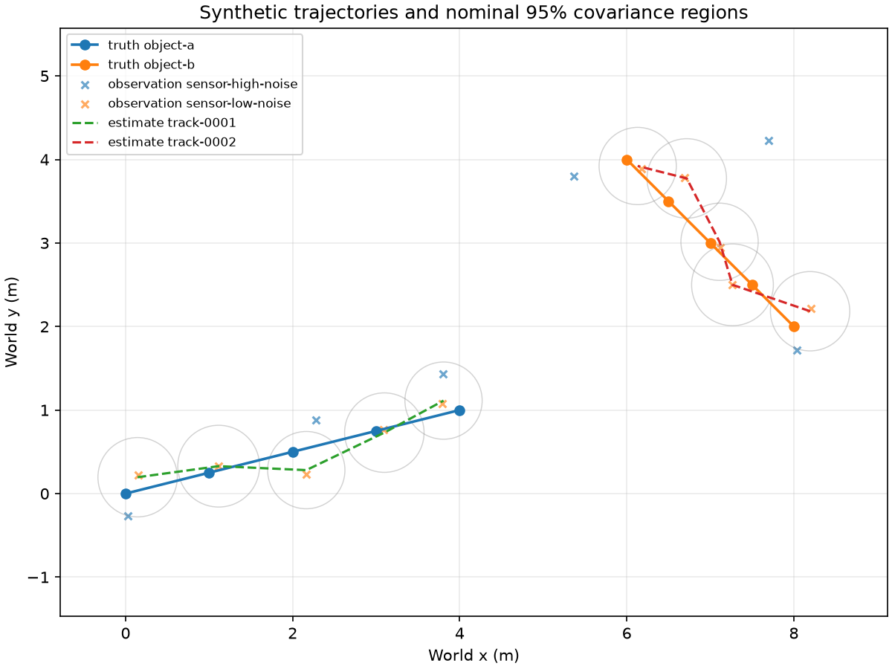

# Multi-Sensor Tracking

Multi-Sensor Tracking is a toolkit for estimating object trajectories from multiple observation streams and comparing tracking methods. It accepts timestamped position observations from generated examples, recorded CSV files, or live JSONL streams. It can score estimates when separate reference trajectories are available.

## Project map

| Path | What belongs there |
| --- | --- |
| `src/mst/` | Installable Python application package: simulation, sensors, trackers, scoring, plots, and CLI. |
| `examples/` | Scenarios to run, a frozen benchmark with measured results, and a small checked-in sample. |
| `docs/EVALUATION.md` | Metric definitions, scoring conventions, benchmark protocol, and limitations. |
| `output/` | Your generated runs; generated files stay local. |

`pyproject.toml` defines installation metadata and runtime dependencies. `src/` contains the importable Python package. Packaging tools may create `build/` or `dist/`; those are disposable generated files.

Inside `examples/`, `scenarios/` contains editable inputs, `benchmark/` keeps its protocol, reproduction code, report, and results together, and `sample/` is a small checked-in output. The many files inside `output/` are local run data and are ignored by Git.

## Run a demo

Use Python 3.11 or newer. From the repository root:

```bash
python3 -m venv .venv
.venv/bin/python -m pip install '.[plot]'
.venv/bin/mst demo --output output/demo --seed 7 --plot
.venv/bin/mst validate --run output/demo
```

`output/demo` must be new. If it already exists, choose another name such as `output/demo-2`. The demo writes a manifest, separate `truth.jsonl` and `observations.jsonl`, `tracks.jsonl`, `innovations.jsonl`, `events.jsonl`, `metrics.json`, and an interactive `inspect.html`; `plot.png` is optional. Open `inspect.html` in a browser to scrub time, filter sensors and tracks, inspect association decisions and covariance, and optionally show reference truth. The tracker receives observations only; truth is read afterward for scoring and visualization. To use a different scenario:

```bash
.venv/bin/mst simulate --config examples/scenarios/degraded.json --output output/degraded --seed 7
.venv/bin/mst track --input output/degraded/observations.jsonl --output output/degraded/tracks.jsonl --innovations output/degraded/innovations.jsonl --events output/degraded/events.jsonl --method multi-kalman
.venv/bin/mst evaluate --run output/degraded --tracks output/degraded/tracks.jsonl --innovations output/degraded/innovations.jsonl --output output/degraded/metrics.json
.venv/bin/mst inspect --observations output/degraded/observations.jsonl --tracks output/degraded/tracks.jsonl --events output/degraded/events.jsonl --innovations output/degraded/innovations.jsonl --output output/degraded/inspect.html
```

`mst --help` lists all commands. `mst track` also supports `baseline` and `kalman` for the one-object scenario. It needs only an observation file, not the run manifest or truth file. Outputs are created exclusively, so commands do not silently replace files.

`mst track` and `mst track-stream` accept `--direction-weight` for an experimental velocity-direction association cost. It defaults to zero, preserving the existing tracker. The [association comparison](examples/association/README.md) found no held-out crossing benefit and a degraded-case regression at weight 4, so this option should not be treated as a validated improvement.

`mst inspect` needs only observation and track files. Its `--events` and `--innovations` inputs are optional; omit them when unavailable. Pass `--truth PATH/TO/truth.jsonl` to add an initially hidden reference overlay, position-error chart, and reference-based ID-switch events. Those are computed for viewing after tracking with exact-time, distance-gated matching (default 10 m). They do not enter the tracker. The HTML file is self-contained and requires no server or plotting extra; its contents include the supplied observations, tracks, and optional reference data, so handle reports from sensitive sources according to their data permissions. Static PNG/SVG plots remain available through `mst plot` for generated runs.

## Use recorded or live observations

For a recorded one-sensor CSV, use the exact header `timestamp_s,observation_id,x_m,y_m`. Coordinates must already be in the shared Cartesian `world` frame in meters; timestamps are nonnegative seconds and ordered. Supply the sensor ID and an explicit fixed isotropic position standard deviation in meters:

```bash
.venv/bin/mst ingest --format csv --input measurements.csv --output output/measurements.jsonl --source-label field_trial_1 --sensor-id camera_1 --position-std-m 0.5
.venv/bin/mst track --input output/measurements.jsonl --output output/measurement-tracks.jsonl --innovations output/measurement-innovations.jsonl --method multi-kalman
```

For a live feed, omit `--input` and pipe version 1 observation JSONL to standard input: `sensor_program | .venv/bin/mst ingest --format jsonl --output output/live.jsonl --source-label stream_1`. The adapter validates and flushes each observation as it arrives, then writes `output/live.source.json` when the stream closes. The JSONL schema includes `sensor_id`, `observation_id`, `timestamp_s`, `position_m`, `covariance_m2`, `frame: "world"`, `time_unit: "s"`, and `schema_version: 1`; it rejects extra fields, including truth identities. Both adapters write a source manifest with assumptions, a user-supplied source label, record count, and output hash. Direct device-specific connectors remain future work. Neither ingest nor tracking requires a truth file. Truth-based evaluation requires a separate validated reference run.

For a Cartesian CSV in a sensor-local frame or different units, provide a [versioned input contract](examples/inputs/README.md) with its time basis, coordinate transform, and uncertainty. The two checked-in frame examples normalize to the same world-frame positions. A [recorded NOAA IBTrACS import recipe](examples/recorded/README.md) demonstrates a distinct time and geographic source without treating it as independent reference truth. The resulting observations still use the version 1 tracker schema. The CSV contract path is optional; the original world-frame CSV and JSONL commands remain supported.

## Track a stream as it arrives

`mst track-stream` reads version 1 observation JSONL from standard input or a replay file and flushes track estimates after each completed time epoch, before the input closes. Give it a source record; the [streaming guide](examples/streams/README.md) explains watermark ordering, bounded late arrivals, dropped-record counts, and resource limits. A [small recorded Laura replay](examples/recorded/README.md) yields the same tracks as batch processing. Source records and stream-quality counts are saved beside the track file. No reference truth enters the streaming tracker.

## Reproduce the benchmark

The benchmark protocol and its measured results live together in [examples/benchmark](examples/benchmark/README.md). Run it into a new local folder, then compare deterministic metrics with the checked-in results:

```bash
.venv/bin/python -m examples.benchmark.run --output output/benchmark-reproduction
.venv/bin/python -m examples.benchmark.verify --actual output/benchmark-reproduction/benchmark.json
```

The results use three held-out seeds and include identity-switch failures in a crossing scenario. They establish behavior only for these synthetic fixtures. See [the evaluation protocol](docs/EVALUATION.md) for matching, uncertainty, and timing definitions.



See [the evaluation protocol](docs/EVALUATION.md) for scoring definitions, benchmark methods, and limitations.
